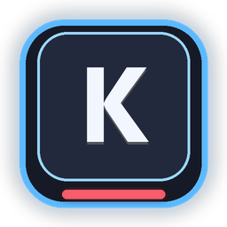

<p align="center">
  
</p>

<h1 align="center">KeyState-RS</h1>

<p align="center">
  <strong>초경량 GPU 가속 Windows 키보드 · 마우스 실시간 오버레이 (Rust 재작성판)</strong>
</p>

<p align="center">
  
  
  
  
  
</p>

---

## 프로젝트 소개

**KeyState-RS**는 오픈소스 [KeyState](https://github.com/RakNib/KeyState)의 **깔끔한 입력 반응성과 Smoothstep 글로우 · 히스토리 트랙 애니메이션**을 계승하면서, 기존 C++ / GDI+ / Win32 스크롤 설정창의 **성능 병목과 답답한 키 배치 UX를 해결하기 위해 Rust로 처음부터 새로 설계한 프로젝트**입니다.

- **GPU 네이티브 투명 오버레이**: `Direct3D 11 + Direct2D 1.1 + DirectWrite + DirectComposition` 파이프라인으로 CPU 비트맵 복사 없이 직접 합성합니다. 입력이 없는 유휴 상태에서는 GPU 렌더링을 완전히 멈추는 **유휴 0fps 절전**을 지원합니다.
- **비주얼 키보드 캔버스 에디터**: 숫자 입력 대신 `egui` 캔버스 위에서 키를 **직접 드래그 이동 · 핸들 리사이즈 · 그리드 스냅 · 다중 선택 정렬**할 수 있습니다.
- **게임 & 안티치트 호환 입력 엔진**: `Raw Input`, `Raw Input + Hook`, `고속 폴링(GetAsyncKeyState)`, `LL Hook` 4가지 백엔드를 실시간 전환할 수 있으며, 상단 원클릭 **관리자 권한 재실행**으로 관리자 권한 게임 위에서도 입력을 감지합니다.
- **단일 실행 파일 (~5MB)**: 외부 런타임이나 WebView 설치 없이 `.exe` 하나로 바로 실행됩니다.

---

## 기존 C++ 버전 대비 개선점

| 항목 | 기존 KeyState (C++ V1.5) | KeyState-RS (Rust) |
|------|--------------------------|--------------------|
| **오버레이 렌더링** | CPU GDI+ 매 프레임 비트맵 생성 + 픽셀 루프 + `UpdateLayeredWindow` | GPU `Direct2D 1.1 + DirectComposition` 스왑체인 직접 합성, 공용 브러시 재사용 |
| **유휴 시 리소스** | 설정 FPS대로 상시 CPU 렌더링 | 이벤트 기반 대기(**유휴 시 GPU 0fps**) |
| **키보드 설정 UI** | 단일 Win32 스크롤 창, 리스트 + 좌표 숫자 입력 | 4탭 모던 UI + **실시간 비주얼 캔버스 에디터** (드래그/리사이즈/정렬/프리셋) |
| **키 추가 방식** | 1개씩 팝업 캡처 | **연속 키보드 추가 모드**, 마우스 5버튼 원클릭 추가, 6종 레이아웃 프리셋 |
| **입력 감지** | `WH_KEYBOARD_LL` / `WH_MOUSE_LL` 고정 | **4종 백엔드 전환**(`Raw Input` / `하이브리드` / `500Hz 고속 폴링` / `LL Hook`) + Lock-free 핫패스 |
| **권한 / 고해상도** | 일반 권한 고정, 96 DPI 고정 | 원클릭 **관리자 권한 재실행** + **Per-Monitor DPI V2** 대응 |
| **프로필 관리** | 단일 설정 파일 | 게임별 **프로필 저장/전환** (`profiles/*.json`) + 원자적 설정 저장 |

---

## 주요 기능

### 1. 비주얼 키 배치 에디터 (`키 배치` 탭)
- **인터랙티브 캔버스**: 키 클릭 선택, 드래그 이동, 우하단 핸들 드래그 리사이즈, 그리드 스냅(`4~32px`), 줌(`0.5x~2.0x`), `Shift+클릭` 다중 선택 정렬(좌측/상단/가로 균등/크기 통일)
- **빠른 키 등록**: `연속 키보드 추가` 모드로 키를 톡톡 눌러 연속 배치 + 마우스 5버튼(`LMB`, `RMB`, `MMB`, `MB4`, `MB5`) 원클릭 추가
- **6종 기본 레이아웃 프리셋**: `WASD + Space`, `FPS`, `리듬게임 4K (DFJK)`, `리듬게임 7K`, `방향키 + Z X`, `AOS (QWER)`
- **배치 모드 전환**: `자유 캔버스` ↔ `자동 가로 1줄`
- **실시간 인스펙터**: 선택 키의 감지 키 재지정, 라벨, 크기 프리셋(`1U`/`Shift`/`Space`/`마우스`), 글자/기본/눌림 색상 개별 또는 일괄 적용, 복제/삭제

### 2. GPU 애니메이션 · 히스토리 트랙 · 실시간 KPS 차트 (`스타일 & 테마`, `트랙 & 통계` 탭)
- **Smoothstep 색상 이징**: 누름/뗌 시간을 각각 조절 가능(기본 80ms / 100ms), 초고속 연타 시에도 끊김 없는 연속 보간
- **3단 글로우 효과**: 외곽 소프트 글로우 + 중간 글로우 + 내부 하이라이트 테두리(강도 조절 가능)
- **히스토리 트랙**: 누르는 동안 바닥에서 성장하고 떼는 순간 일정 속도로 상승하며 페이드아웃되는 노트 트랙(화면 상단 클램핑 및 키별 상단 정렬)
- **통계 박스 & BPM 분석**: 개별 키 Total/KPS, 별도 합계·KPS·BPM 박스(8/16/32/64분음표, 동시 입력 병합 시간 0~100ms)
- **별도 KPS 차트 오버레이**: 꺾은선 / 산점도 / 막대 차트, 그라데이션 채우기, 동적 Y축 스무딩, 오버레이 하단 자동 스냅
- **16종 내장 테마 + 커스텀 테마 편집**: 반응형 카드 그리드에서 원클릭 적용 및 실시간 색상 수정

### 3. 게임 호환 입력 엔진 & 프로필 (`프로필 & 일반` 탭)
- **4가지 입력 감지 백엔드**:
  - **Raw Input (권장)**: Windows HID 드라이버 직접 수신 (IME `VK_PROCESSKEY` 문제 없음, LL 훅 미설치)
  - **Raw Input + Hook (하이브리드)**: 하드웨어 키 + 가상/매크로 입력 동시 감지
  - **고속 폴링 (`GetAsyncKeyState`, 500Hz)**: 훅과 Raw Input까지 제한하는 특수 안티치트 게임 대응
  - **LL Hook 단독**: 전통적인 `WH_KEYBOARD_LL` / `WH_MOUSE_LL` 방식
- **관리자 권한 자동 감지 & 원클릭 재실행**: 게임이 관리자 권한으로 실행되어 UIPI로 입력이 막힐 때 상단 `▲ 관리자 실행` 버튼 한 번으로 승격
- **게임별 프로필 저장/전환** 및 **초당 KPS/Total JSON 녹화** (`records/*.json`)

---

## 조작법 및 글로벌 단축키

| 동작 / 단축키 | 설명 |
|---|---|
| **오버레이 키 박스 드래그** | 오버레이 창 위치 이동 (투명 빈 공간은 클릭 통과) |
| **오버레이 / 트레이 우클릭** | 팝업 메뉴 (설정 열기 / 오버레이 토글 / 카운트 초기화 / 관리자 재실행 / 종료) |
| **트레이 좌클릭** | 설정 창 열기 |
| **설정 창 `X` 버튼** | 앱 종료 없이 시스템 트레이로 최소화 |
| `Ctrl + Shift + K` | 설정 창 열기 |
| `Ctrl + Shift + M` | 오버레이 표시 / 숨김 |
| `Ctrl + Shift + N` / `P` | 다음 / 이전 테마 프리셋 전환 |
| `Ctrl + Shift + H` | 히스토리 트랙 표시 토글 |
| `Ctrl + Shift + U` | 실시간 KPS 차트 표시 토글 |

> 모든 글로벌 단축키와 녹화 시작/중지 단일 키는 `프로필 & 일반` 탭에서 자유롭게 변경·해제할 수 있습니다.

---

## 빌드 및 실행

### 요구 사항
- Windows 10 / 11 (x64)
- [Rust 툴체인](https://rustup.rs/) (`x86_64-pc-windows-msvc`) 및 Visual Studio C++ Build Tools

### 빌드 명령어
```powershell
git clone https://github.com/ForUltraplayer/KeyState.git
cd KeyState\rust-overlay
cargo build --release
```

빌드가 완료되면 아래 단일 실행 파일이 생성됩니다:
```powershell
.\target\release\keystate-rs.exe
```

### 실행 시 생성되는 파일 (`.exe`와 같은 폴더)
- `keystate_config.json` — 메인 설정 및 키별 누적 카운트 (자동 저장, 원자적 교체)
- `profiles/<프로필명>.json` — 게임별 저장 프로필
- `records/KeyStateRecording_YYYYMMDD_HHMMSS.json` — 녹화된 초당 KPS/입력 기록

---

## 프로젝트 구조

```text
rust-overlay/
├── Cargo.toml
├── build.rs                 # Windows .exe 아이콘 및 메타데이터 리소스 임베딩
├── assets/
│   ├── icon.ico             # 멀티 해상도(16~256px) 앱/트레이 아이콘
│   ├── icon.png             # 256px 아이콘 이미지
│   └── icon_64.rgba         # 설정 창 타이틀바용 임베딩 RGBA 데이터
└── src/
    ├── main.rs              # 진입점, DPI V2 초기화, 스레드 오케스트레이션
    ├── state.rs             # Lock-free 입력 Atomic 미러, 공유 상태, 비동기 녹화 저장
    ├── config/
    │   ├── mod.rs           # AppConfig, KeyConfig, InputMode, 레이아웃 크기 계산
    │   ├── presets.rs       # 6종 키보드 프리셋 & 16종 테마 프리셋
    │   └── storage.rs       # 설정/프로필 검증 및 원자적 JSON 저장/로드
    ├── input/
    │   ├── hook.rs          # Raw Input, 동적 LL 훅, 500Hz 폴러, 트레이, 단축키, UAC 승격
    │   ├── keycode.rs       # Windows VK 코드 ↔ 표시 라벨 매핑
    │   └── state.rs         # KeyStateManager (Total, KPS, BPM, PressStamp)
    ├── overlay/
    │   ├── mod.rs           # GPU 렌더 루프, 프레임 페이싱, 유휴 0fps 절전, Device Lost 복구
    │   ├── d2d.rs           # Direct3D11 + Direct2D 1.1 + DirectWrite + DirectComposition
    │   ├── anim.rs          # Smoothstep 연속 이징 보간기
    │   ├── display.rs       # 메인 키 오버레이 (3단 글로우, 히스토리 트랙, 통계 박스)
    │   └── chart.rs         # 실시간 KPS 차트 오버레이 (꺾은선/산점도/막대)
    └── ui/
        ├── mod.rs           # egui 설정 창, 한글 시스템 폰트 로더, 반응형 도킹 패널
        ├── canvas.rs        # 비주얼 키보드 캔버스 에디터 & 속성 인스펙터
        ├── style_tab.rs     # 외형·애니메이션 & 반응형 테마 프리셋 그리드
        ├── track_tab.rs     # 히스토리 트랙 · 통계 박스 · KPS 차트 설정
        └── general_tab.rs   # 프로필 · 입력 백엔드 · 관리자 권한 · 단축키 · 녹화
```

> 기존 C++ 원본 소스는 저장소의 `src/` 디렉토리에 보존되어 있습니다.

---

## 게임에서 키 입력이 안 잡힐 때

1. **관리자 권한 게임**: 설정 창 우상단의 **`▲ 관리자 실행`** 버튼을 눌러 관리자 권한으로 재실행하세요. (Windows UIPI 정책상 일반 권한 오버레이는 관리자 권한 게임의 입력을 받을 수 없습니다.)
2. **특수 안티치트 게임**: `프로필 & 일반` → `입력 감지 방식`에서 **`고속 폴링 (안티치트 대응)`**으로 전환하세요.

---

## 라이선스

이 프로젝트는 **MIT License**를 따릅니다. 원본 프로젝트 [RakNib/KeyState](https://github.com/RakNib/KeyState)의 MIT 라이선스 및 저작권 고지를 존중합니다.
